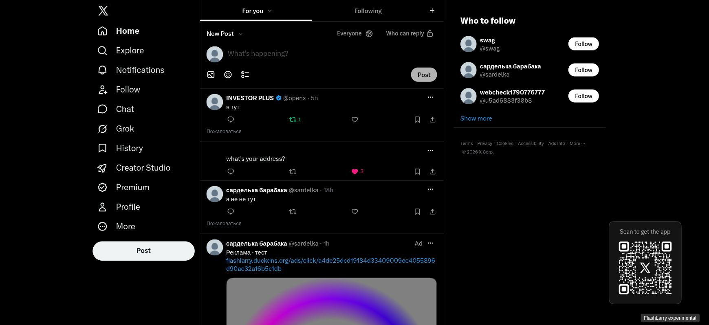
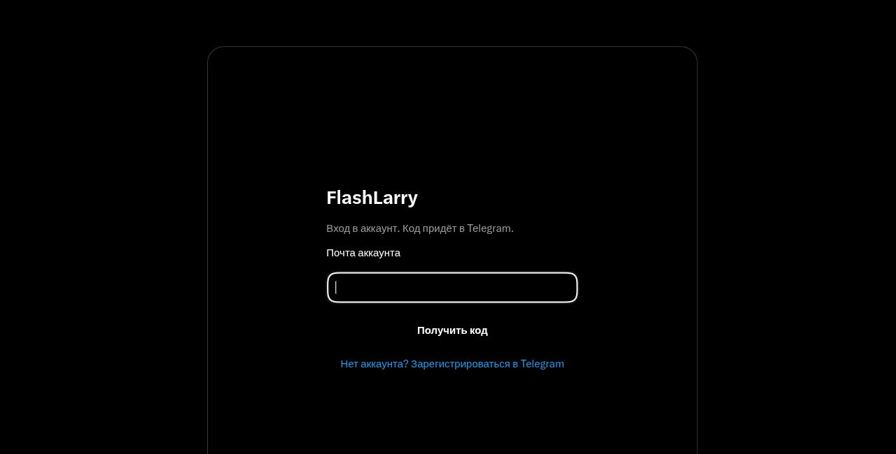

# OpenXGQL-Server

[](https://github.com/openxgql/OpenXGQL-Server/actions/workflows/go.yml)
[](LICENSE)
[](go.mod)
[](docs/compatibility.md)
[](https://www.postgresql.org/)
[](https://redis.io/)
[](deploy/Caddyfile)
[](cmd/bot)
[](#deploy-on-ubuntu)
[](docs/compatibility.md)

Experimental Go backend used by **FlashLarry**. It implements local social
network storage and responses shaped for captured X GraphQL operations.
Postgres stores accounts and social data; Redis stores sessions, codes and
feed snapshots; Caddy terminates HTTPS.

## Screenshots

The FlashLarry web interface connects the patched X client to OpenXGQL-Server.
Captured from the running deployment on October 1, 2026.

### Timeline and navigation



### Profile


### Login



## Features

- Tweets, replies, likes, reposts, search, profiles, usernames, avatars and media.
- Followers, private follow requests, blocks, mutes, bookmarks and lists.
- Stored communities, articles, notes, drafts and scheduled posts.
- Telegram registration and login codes, inline bot controls and 3 Stars Premium.
- Alternative email-code mode with SMTP settings in the admin panel.
- Admin verification/Premium, suspension/restoration, reports, advertisements,
  per-account ranking priority and chronological/algorithmic feed selection.

The registry contains **634 name/ID pairs**: 524 included and 110 excluded
(Grok, direct messages, Creator Studio/analytics and X payments). Those counts
describe routing coverage. They do not establish that every operation matches
the official clients. Spaces, broadcasts, sports and other catalogs use local
records; this server does not provide their upstream infrastructure.

See [compatibility and implementation scope](docs/compatibility.md) and the
[recommendation port scope](internal/xalgorithm/README.md). The ranking core is
adapted from x-algorithm; probabilities are local estimates, not Phoenix inference.

## Services

| Service | Listen address | Responsibility |
| --- | --- | --- |
| gateway | 127.0.0.1:8080 | GraphQL, web/mobile compatibility, auth cookies |
| users | 127.0.0.1:8081 | Accounts, sessions, email/Telegram authentication |
| tweets | 127.0.0.1:8082 | Posts, reactions, signed media |
| social | 127.0.0.1:8083 | Extended operations, moderation, feeds, ads |
| admin | 127.0.0.1:8084 | Admin UI and API |
| bot | outgoing polling | Telegram registration, OTPs, Stars invoices |

The internal services are intended for loopback use behind Caddy. The social
service requires the generated internal token. Database migrations run at
service startup. The module name remains `flashlarry-api` for existing imports.

## Build and test

Go 1.26 or newer, Python 3, Postgres, Redis and Caddy are required for deployment.

```sh
make test
make build
```

Database integration tests are skipped unless `FLASHLARRY_TEST_DATABASE_URL`
points to a disposable database containing `flashlarry_integration` in its name.
See [verification](docs/compatibility.md#verification) before running them.

## Deploy on Ubuntu

Point your domain's DNS at the server. Open TCP 80/443, UDP 443 if using HTTP/3,
and TCP 2600 if the separate admin address is needed.

```sh
make build
sudo mkdir -p /opt/flashlarry/source /opt/flashlarry/staging
sudo cp -a cmd internal deploy scripts reference go.mod go.sum /opt/flashlarry/source/
sudo cp build/* /opt/flashlarry/staging/
sudo OPENXGQL_DOMAIN=flashlarry.duckdns.org bash deploy/install.sh
```

The installer installs system packages, creates a local database/service user,
generates internal/encryption secrets, installs systemd units and replaces the
Caddy configuration (the previous configuration is backed up). Runtime files
keep their existing `/opt/flashlarry` and `/etc/flashlarry` locations.
For another domain, set `OPENXGQL_DOMAIN` and use the same origin for the patcher.
Media, bot links and ads use `PUBLIC_BASE_URL` in `/etc/flashlarry/common.env`.

Generate the web assets separately with
[OpenXGQL-Client-Patcher](https://github.com/openxgql/OpenXGQL-Client-Patcher):

```sh
python -m openxgql_client_patcher \
  --backend-url https://flashlarry.duckdns.org --output ./patched
sudo mkdir -p /opt/flashlarry/web
sudo cp -a patched/. /opt/flashlarry/web/
```

Admin is available at `https://YOUR-DOMAIN/admin/` and
`https://YOUR-DOMAIN:2600/`. Read its generated 100-character password from
`/root/flashlarry-admin-credentials.txt` on your server. No deployment credentials,
account database or downloaded X JavaScript bundles are included here.

### Configure login

For Telegram mode, add your own `TELEGRAM_BOT_TOKEN` and
`TELEGRAM_BOT_USERNAME` to `/etc/flashlarry/common.env`, restart users/gateway
and enable `flashlarry-bot`. Set Telegram mode in the admin panel.
Bot registration produces an account email such as `name@flashlarry.test`;
the website accepts login codes delivered by the bot.

For email mode, select it under **Лента и вход**, enter SMTP host, port, TLS or
STARTTLS, username, sender and password. The bot stops serving authentication
and purchases in this mode. Premium and verification are granted in admin.
SMTP passwords are encrypted with `SETTINGS_ENCRYPTION_KEY`; back up this key
together with Postgres. Codes are one-use and expire after five minutes.

## Operation metadata

`internal/social/operations.json` is the embedded registry. Rebuild it with
`python3 scripts/build_registry.py`; captured web selections are recovered from
the compiled registry unless `reference/relay-schema.json` is supplied.

To recapture Relay descriptors from unmodified downloaded assets:

```sh
npm install --prefix scripts
node scripts/extract_relay.cjs /path/to/x-web/x-web reference/relay-schema.json
python3 scripts/build_registry.py
```

Adding a new descriptor does not implement its semantics. Review its handler,
input validation and response shape before extending compatibility.

## License

OpenXGQL-Server's own code is licensed under the [MIT License](LICENSE).
The retained x-algorithm source fixtures and upstream portions of the
recommendation adaptation keep their Apache 2.0 terms; see
[NOTICE](NOTICE) and [the upstream license](internal/xalgorithm/upstream/LICENSE).
X/Twitter interface assets retain their upstream ownership. This is an
independent experimental project, not an official X service.
